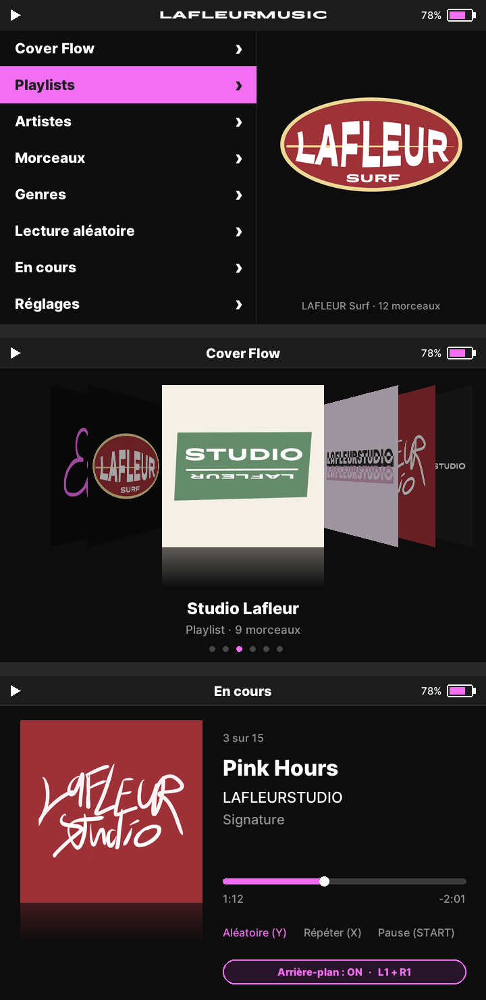

# LAFLEURMUSIC

An **iPod Classic (6th gen)–style music player** for **ROCKNIX** handhelds, in the **LAFLEURSTUDIO** look.
iPod menus, **Cover Flow**, **background playback** while you play games, and the screen turns off when you close the lid.



## Features

- Main menu: Cover Flow, Playlists (albums), Artists, Songs, Genres, Shuffle Songs, Now Playing, Settings.
- **Cover Flow** of your albums with their artwork (embedded cover art, cached on the card).
- **Background mode** (L1 + R1): ON keeps the music playing after you quit the app, even in games; OFF (default) stops the music when you quit.
- **Lid**: background ON → screen off, music keeps playing; background OFF → pause and screen off, resumes when you open it.
- UI in **English** or **French**, following the console language.

## Controls

| Button | Action |
|---|---|
| D-pad | navigate (← → skip tracks in Now Playing) |
| A / B | open / back |
| START | play / pause |
| SELECT | go to Now Playing |
| L1 / R1 | previous / next track |
| L1 + R1 | background mode ON / OFF |
| Y / X | shuffle / repeat (off → all → one) |
| MENU | quit |

## How it works

- **Audio engine**: MPD 0.23 (the aarch64 binary from the PortMaster "Music Player Daemon" port), which keeps playing in the background.
- **UI**: LÖVE 11.5 (Lua), talking to MPD over TCP on `127.0.0.1:6601`.
- **Lid watcher** (`lidwatch/`): a small windowless LÖVE app that reads the lid switch and controls the backlight.
- Music is read from `/storage/roms/music`.

Tested on the **Anbernic RG SP** (720×480) with **ROCKNIX 20261001**. Other screen sizes are in progress.

## Install (from a Mac or PC on the same Wi-Fi)

1. On the console, enable **Samba** (START > Network Settings > Enable Samba).
2. `tools/fetch-vendor.sh` downloads MPD and LÖVE from the official PortMaster releases (md5 checked).
3. `tools/build.sh` assembles `build/lafleur-music/`.
4. `RGSP_HOST=<console ip> tools/install.sh` copies the app to `/storage/roms/lafleur-music/` and the launcher into the **Music** menu.
5. On the console: START > Game Settings > Update Gamelists, then **Music > LAFLEURMUSIC**.

So that closing the lid does not suspend the console (which would stop the music), add
`/storage/.config/logind.conf.d/80-lafleur-clapet.conf`:

```ini
[Login]
HandleLidSwitch=ignore
HandleLidSwitchExternalPower=ignore
HandleLidSwitchDocked=ignore
```

## Tests

```bash
luajit tests/run.lua
```

The logic (MPD protocol, library, language, settings, buttons, Cover Flow, lid) is tested with LuaJIT; the UI is checked on the console.

## Licenses

- **Code**: MIT, see [LICENSE](LICENSE).
- **LAFLEURSTUDIO / LAFLEURMUSIC logos and brand** (`ui/assets/fleur*.png`, `ui/assets/logo-texte*.png`, `docs/images/`): © LAFLEURSTUDIO, all rights reserved. They are **not** covered by the MIT license.
- **Inter** (`ui/assets/fonts/`): SIL Open Font License 1.1.
- **MPD** (GPL-2.0) and **LÖVE** (zlib) are not included in this repository: `tools/fetch-vendor.sh` downloads them from PortMaster, together with their licenses.
